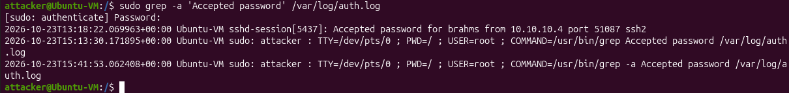
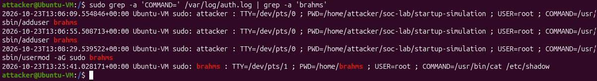
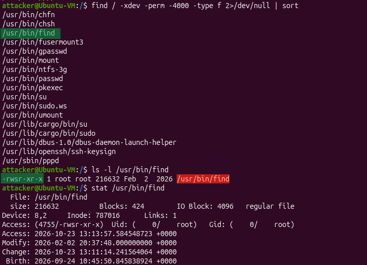
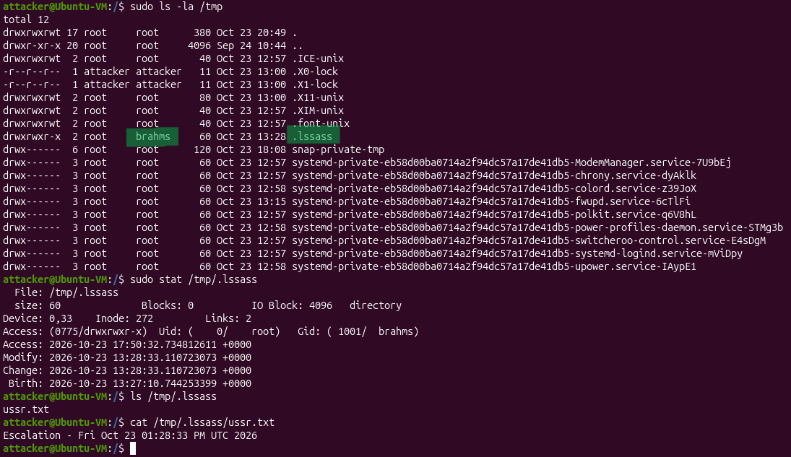
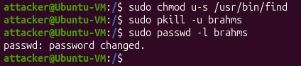

# Alert: Intruder in Linux File System

In this case, we have been notified of a possible data breach, so we need to investigate if the breach occurred and reconstruct the event.

This is categorized as a Privilege Escalation and Credential Access-type MITRE ATT&CK tactics, since the intruder gained higher-level permissions to access sensitive resources.

## Context

If an intruder gets access to a Linux system, knowledge of its commands and file distribution is critical to extract valuable information. This allows them to quickly check the most important locations, hide their history, their Indicators of Compromise (IoCs) and leave hidden files for persistence.

It is also important to understand how the permissions work in Linux. Aside from the usual write-read-execute permissions, the Set User ID (SUID) bit is a special type of permission that allows any user to run a file using the file owner's privileges instead of their own. In particular, this is dangerous when the file owners are root users, as it grants users freedom to execute the file (which might be a command) for malicious purposes and without restrictions.

## Analysis
The first thing we do is search for suspicious login activity. To do this, we search for the 'Accepted password' general expression inside the authentication logs, which are stored in /var/log/auth.log 

Excluding the authentication needed to run the grep command, we observe the following information:

| Field          | Content | Comments |
| -------------  | --------------- | ------------------ |
| User Name        | brahms         | The compromised user |
| IP Address           | 10.10.10.4      | Not the IP address from the host computer. Effectively, the logon came from an external source        |
| Network Protocol        | SSH2         | The protocol used by the intruder to connect to the server and authenticate as the compromised user |
| Timestamp      | Oct 23, 2026 @ 13:18:22         | The authentication time |

This confirms a foreign entity accessed the server, using the user brahms. Next, we perform another general expression search to look for commands the intruder and that required authentication.

Looking only at the event after the authentication time, it confirms the intruder accessed the /etc/shadow file, which stores users' information, including hashed passwords. 

We suspect some executable might have elevated privileges that it shouldn't have. Therefore, we search over root for files with SUID bits set (-perm -4000):

Upon inspection, we find that /usr/bin/find has the SUID bit set, which is abnormal as it usually doesn't require such permissions to execute. Later, we see that the owner is root, which means any user running this command will do it as a root user.

Further investigation detected no other credential access events. However, when looking for persistence-related events, a suspicious folder was encountered inside the /temp/ directory and created by the compromised user:

The folder is named .lssass, which is a misspelling for LSASS, a Windows system process that is in charge of managing security policies and user authentication. Inside this folder there is a text file, which after carefully opening it had some harmless text, and is concluded to have been left as a misdirection.

## Conclusion

The intruder accessed the server via SSH2 and authenticated as the user brahms. He then proceeded to use the find command, which granted any user root privileges upon execution, to search for sensitive data by exploring the Linux file system. 

Containment was performed, by removing the SUID bit from the /usr/bin/find utility, then stopping all processes being run by the user, and locking their password to prevent re-authentication. 

